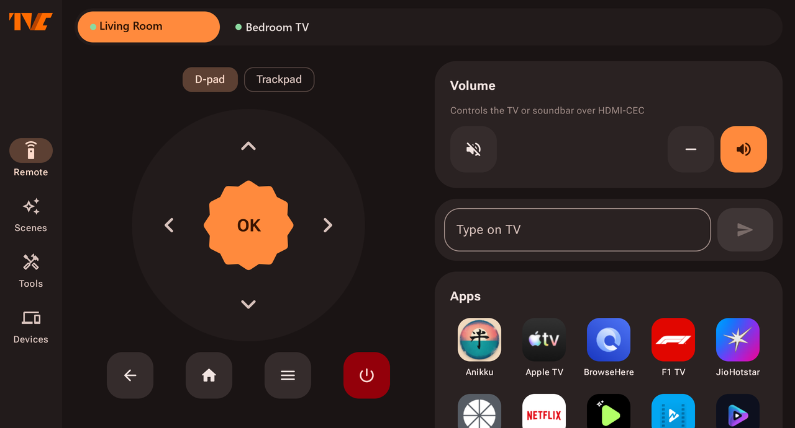
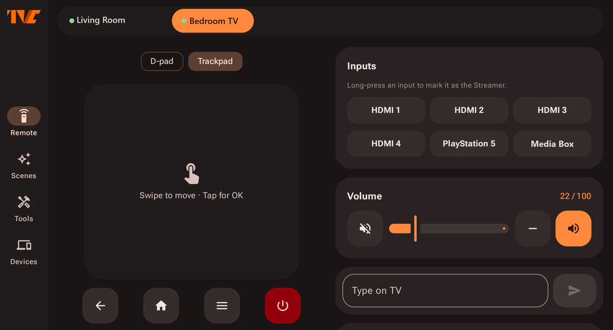
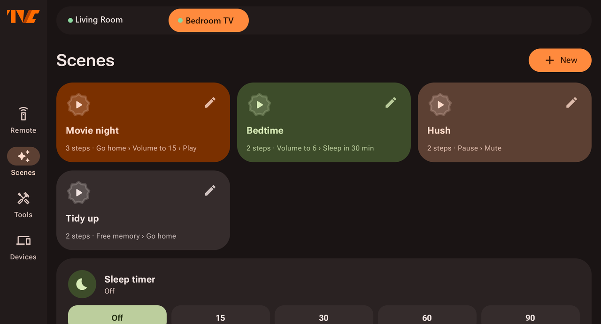
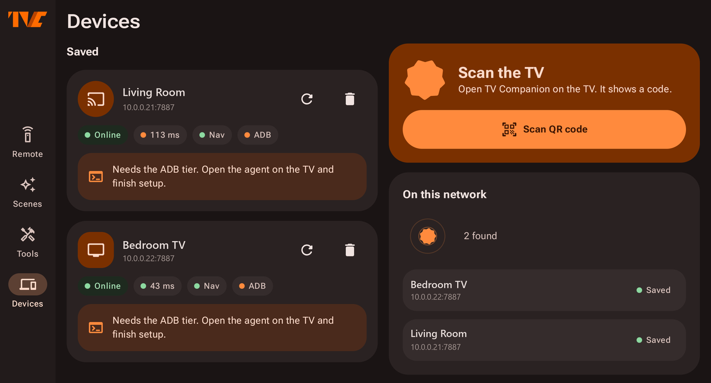

<div align="center">

# TV Companion

**Your phone is the remote. Every TV in the house, one app.**

A **TV Companion Agent** runs on each Android / Google TV device. The **Mobile Companion App** finds them on your Wi-Fi and puts a full remote, trackpad, keyboard, app launcher, input switcher and debloater in your pocket — for as many TVs as you own. No cloud, no account, no IR blaster.

    



</div>

## Screenshots

| Trackpad + HDMI inputs | Scenes |
|---|---|
|  |  |
| **Multiple TVs, auto-discovered** | **D-pad remote + app launcher** |
|  |  |

## Features

| | |
|---|---|
| **Multi-TV control** | Add any number of TVs and boxes. Each gets its own tab with live status, latency and tier chips; switch between them with one tap. Agents are found automatically over mDNS. |
| **Remote** | D-pad, OK, Back, Home, Recents, power menu, media keys, volume slider and mute. |
| **Trackpad** | Flip the D-pad into a trackpad: swipe to move focus, tap for OK. Long swipes step through rows fast, with haptics on every step. |
| **Input switching** | The TV tab lists its HDMI ports. Mark the port your media box is on and one button switches input *and* jumps to that box's tab. |
| **Keyboard** | Type on the phone; text lands in whatever field has focus on the TV. |
| **App launcher** | Icons for every launchable app on the device, one tap to open. Force-stop from Tools. |
| **Scenes** | Multi-step macros with per-step delays — *Movie night*, *Bedtime*, *Hush*, *Tidy up* out of the box, fully editable. |
| **Housekeeping** | Sleep timer, reboot, free memory, memory stats, Private DNS toggle, "now playing" card. |
| **Debloat** | Three-tier catalog (safe / optional / risky). Toggle per package from the phone or in bulk from a PC. One-tap *Restore all*. |
| **Sideload & mirror** | `POST /install` pushes an APK to the TV; `GET /screenshot` grabs the current frame. |

Everything stays on your network. Each agent mints a random bearer token on first launch and the app must present it on every request.

## How it fits together

```
 ┌──────────────────────┐   Wi-Fi · token-authed WebSocket   ┌────────────────────────┐
 │                      │ ─────────────────────────────────► │  TV Companion Agent    │  TV #1
 │  Mobile Companion    │ ─────────────────────────────────► │  TV Companion Agent    │  TV #2
 │  App (Compose)       │ ─────────────────────────────────► │  TV Companion Agent    │  TV #n
 └──────────────────────┘   mDNS discovery  ·  port 7887     └────────────────────────┘
                                                                        ▲
 ┌──────────────────────┐                                               │ adb (wireless debugging)
 │  PC script           │ ──────────────────────────────────────────────┘
 └──────────────────────┘   bulk debloat / package dump
```

| Path | What it is |
|---|---|
| [`agent/`](agent/) | **TV Companion Agent** — Android TV app installed on every TV you want to control. Hosts a small HTTP + WebSocket server and performs the key presses. |
| [`phone/`](phone/) | **Mobile Companion App** — discovers agents via mDNS, one tab per TV. |
| [`shared/`](shared/) | Wire protocol (`Protocol.kt`), scene definitions, debloat catalog loader, shell-command allowlist. Agent and app compile against the same source. |
| [`scripts/debloat.ps1`](scripts/debloat.ps1) + [`debloat/packages.json`](debloat/packages.json) | PC-side bulk debloat over `adb`. The app bundles the same JSON at build time. |

### Privilege tiers

A normal Android TV app cannot press keys in other apps, so the agent has two tiers and uses whichever is available:

| Tier | Needs | Unlocks |
|------|-------|---------|
| **Accessibility** | Enable "TV Companion remote control" under Settings > System > Accessibility | D-pad, trackpad, OK, Back, Home, Recents, power menu, typing, app launch, HDMI input switch, sleep timer |
| **ADB** (optional) | Wireless debugging paired once from the agent's setup screen; the agent reconnects on every boot | Debloat, reboot, free memory, force-stop, Private DNS, now-playing, raw keycodes, screenshot, APK install — plus a fallback for everything above |

Media keys and volume work with **neither** tier enabled.

## Build

Requires JDK 17+ (Android Studio's bundled JDK works) and the Android SDK with platform 37.

```powershell
$env:JAVA_HOME = "C:\Program Files\Android\Android Studio\jbr"
.\gradlew.bat :agent:assembleDebug :phone:assembleDebug
```

APKs land in `agent/build/outputs/apk/debug/agent-debug.apk` and `phone/build/outputs/apk/debug/phone-debug.apk`.

## Install

### TV Companion Agent — on every TV

Install over ADB rather than through a downloader app: Android 13+ blocks the accessibility toggle for apps installed by a "restricted" source, and ADB installs are exempt.

1. On the TV: Settings > System > About > tap "Android TV OS build" 7 times. Then Settings > System > Developer options > Wireless debugging > on.
2. On the PC, with the TV's IP and the pairing port/code from "Pair device with pairing code":
   ```powershell
   adb pair <tv-ip>:<pairing-port>
   adb connect <tv-ip>:<connect-port>
   adb install -r agent\build\outputs\apk\debug\agent-debug.apk
   ```
   Tip: `adb mdns services` lists every device on the LAN with wireless debugging on.
3. Open "TV Companion Agent" from the apps row. It shows the server status, the token and a QR code.
4. Press "Accessibility settings" and enable "TV Companion remote control". The status line flips to "enabled".
5. **Optional ADB tier** (debloat and housekeeping extras): on the agent screen press "Developer options", open Wireless debugging > "Pair device with pairing code", type the port and 6-digit code into the agent's fields, press Pair, then "Connect (auto)". If auto-connect cannot find the port, type the port shown under Wireless debugging into "Connect port" and press Connect. The agent reconnects on boot as long as Wireless debugging stays on.

Repeat for each TV. If you sideloaded through a browser or file manager and the accessibility switch is greyed out: Settings > Apps > TV Companion Agent > three-dot menu > "Allow restricted settings".

### Mobile Companion App

Install `phone-debug.apk` and open **Devices**. Agents on the same Wi-Fi appear under "On this network"; tap **Add** and enter the token from the TV screen — or tap **Scan QR code** and point the camera at the TV. Add as many TVs as you like.

## Using it

- Tabs along the top switch between TVs. Each tab keeps its own connection, so switching is instant.
- On the remote, the **D-pad / Trackpad** chips swap the control surface. In trackpad mode, every ~48 dp of swipe is one D-pad step in the dominant direction; a tap is OK.
- On a TV with HDMI inputs, long-press the port your media box is plugged into to mark it. A one-tap "switch and control" button then changes the source and jumps to that box's tab.
- **Scenes** holds the macros. Each step is any remote / media / volume / text / app / input / sleep-timer / free-memory command with an optional delay (up to 20 steps, 30 s per delay). Reboot, debloat and DNS are deliberately not scriptable.
- **Debloat** appears under Tools once a TV's ADB tier is connected. Safe-tier packages toggle immediately; risky ones ask first.

## Debloat from a PC

```powershell
# dry-run table of what the catalog would touch
.\scripts\debloat.ps1 -Target <tv-ip>:<connect-port> -Action list -Tier all

# disable the safe tier
.\scripts\debloat.ps1 -Target <tv-ip>:<connect-port> -Action disable -Tier safe -Confirm

# put everything back
.\scripts\debloat.ps1 -Target <tv-ip>:<connect-port> -Action restore -Tier all -Confirm

# full package dump, useful for extending debloat/packages.json
.\scripts\debloat.ps1 -Target <tv-ip>:<connect-port> -Action dump
```

`packages.json` has three tiers. Edit it to taste; the app bundles the same file at build time. Package names that do not exist on a device fail harmlessly.

## Talk to the agent directly

The agent speaks plain HTTP on port `7887`, bearer-token authed:

```bash
TOKEN=<token-from-tv>; TV=<tv-ip>
curl -H "Authorization: Bearer $TOKEN" http://$TV:7887/info      # tiers, version, device name
curl -H "Authorization: Bearer $TOKEN" http://$TV:7887/inputs    # HDMI ports (empty on boxes without inputs)
curl -H "Authorization: Bearer $TOKEN" http://$TV:7887/apps      # launchable apps with icons
curl -H "Authorization: Bearer $TOKEN" http://$TV:7887/screenshot -o shot.png          # needs ADB tier
curl -H "Authorization: Bearer $TOKEN" --data-binary @app.apk http://$TV:7887/install  # needs ADB tier
```

Commands go over the `/ws` WebSocket as `{"id": n, "command": {"type": "...", ...}}`; the full set is the `Command` sealed class in [`shared/.../Protocol.kt`](shared/src/main/kotlin/com/questorylabs/tvc/shared/Protocol.kt).

## Known limits

- **Power on.** "Power" opens the TV's power menu through accessibility; with the ADB tier it sends `KEYCODE_POWER`. Waking a sleeping TV is not possible without HDMI-CEC control, which apps cannot drive.
- **Older firmware.** Below Android 13 the D-pad and trackpad use a focus-search fallback that can miss custom views. Enabling the ADB tier fixes that.
- **Wireless debugging resets.** Some firmwares turn it off after a reboot; the ADB tier then needs re-enabling. Navigation does not depend on it.
- **Catalog provenance.** `debloat/packages.json` has not been checked against a real `pm list packages` dump on every model — run `-Action dump` and prune before trusting the risky tier.
